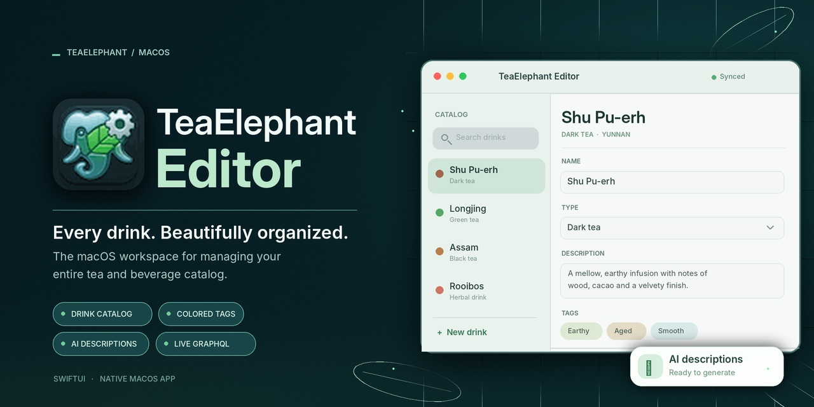

# TeaElephantEditor



TeaElephantEditor is the macOS administration app for TeaElephant's shared drink
catalogue. Create and edit tea, coffee, herb and other drink entries, organise
them with coloured tags, and ask the backend to generate a description. The
sidebar receives catalogue and tag changes through GraphQL subscriptions.

The editor maintains the catalogue used by the iOS app. Personal collections,
NFC writing and QR label assignment belong to the mobile app.

## What the editor does

- **Edit the catalogue:** browse drinks, add a draft, edit its name/type/description,
  save changes, or delete an existing entry.
- **Generate descriptions:** request a description from the backend for the
  entered name, including before the draft is first saved. The generated text
  remains editable.
- **Organise drinks:** create tag categories and coloured tags, then attach or
  remove tags on a saved drink.
- **Follow live changes:** update sidebar entries and tag indicators after
  creation, modification, deletion and tag-assignment events.
- **Recover from failures:** show operation errors and allow retrying a failed
  detail load; only confirmed mutations display a saved state.

The schema includes additional tag/category mutations whose presence in
generated code does not imply that every operation has a corresponding UI.

## Part of the TeaElephant product

| Repository | Responsibility |
| --- | --- |
| [Editor](https://github.com/teaelephant/Editor) | macOS administrative catalogue editor |
| [teaElephant](https://github.com/teaelephant/teaElephant) | iOS app, NFC/QR labels, personal collections and recommendations |
| [TeaElephantMemory](https://github.com/teaelephant/TeaElephantMemory) | Go GraphQL backend, PostgreSQL storage, authentication and AI integration |

Editor signs administrative requests with a dedicated key. Signing in to the
iOS app with Apple does not grant catalogue administration privileges.

## Requirements

- **macOS 26.6 or newer**, matching the app's deployment target.
- Xcode with a compatible macOS SDK and a **Swift 6.1 or newer compiler** for
  the generated schema package. The current development toolchain is Xcode 27;
  the editor app target itself uses Swift 5 language mode.
- A reachable TeaElephant GraphQL backend for live data and subscriptions.
- A provisioned administrative key in the editor's accessible Keychain for
  protected catalogue mutations. See [admin authentication](SETUP_ADMIN_AUTH.md).
- An Apple developer account and appropriate signing profiles for signed
  builds and TestFlight uploads.

Swift Package Manager resolves the committed dependencies:

| Package | Version | Use |
| --- | --- | --- |
| Apollo iOS | 2.4.0 | Typed GraphQL, HTTP/WebSocket transport and cache |
| Regex | 1.2.0 | Form validation |

See [dependency maintenance](docs/DEPENDENCIES.md) when updating these packages.
Compilation and the mocked unit suite do not require an admin key or an OpenAI
API key. Live AI requests use the backend's provider credentials.

## Build and run

```sh
git clone https://github.com/teaelephant/Editor.git
cd Editor
open TeaElephantEditor.xcworkspace
```

In Xcode, select the shared `TeaElephantEditor` scheme and the Mac destination.
For a command-line build and a separate launch:

```sh
xcodebuild -workspace TeaElephantEditor.xcworkspace -scheme TeaElephantEditor \
  -configuration Debug -destination "platform=macOS,arch=$(uname -m)" \
  -derivedDataPath .build/DerivedData build
open -n .build/DerivedData/Build/Products/Debug/TeaElephantEditor.app
```

The convenience script also supports running, LLDB, logging and process
verification:

```sh
./script/build_and_run.sh --verify
```

**Save open editor work first:** the script stops all processes named
`TeaElephantEditor` before rebuilding, including an installed copy. Use the
separate build/launch commands above when you need to keep that copy running.
Script modes and cache overrides are described in
[dependency maintenance](docs/DEPENDENCIES.md).

## Backend and administrative access

[Network.swift](TeaElephantEditor/Network.swift) defines the runtime endpoints:

| Connection | Default endpoint |
| --- | --- |
| GraphQL queries and mutations | `https://tea-elephant.com/v2/query` |
| GraphQL subscriptions | `wss://tea-elephant.com/v2/query` |
| Schema introspection for code generation | `http://localhost:8080/v2/query` |

The introspection endpoint is configured separately in
[apollo-codegen-config.json](TeaElephantEditor/apollo-codegen-config.json).
Changing that file does **not** redirect the running app. Update both runtime
URLs together to use another server. The backend's
[Docker Compose guide](https://github.com/teaelephant/TeaElephantMemory#local-setup-with-docker-compose)
describes local server setup.

`AdminAuth` loads the P-256 private key from Keychain and signs an ES256 JWT
with `iss=TeaElephantEditor`, `aud=tea-elephant-api` and `admin=true`.
`AuthInterceptor` attaches the token to HTTP requests; subscriptions receive it
in WebSocket `connection_init`. The server needs the matching public key.

The current app has no key-import screen. Its legacy PEM import helper also
stores a different Keychain item class from the one the loader reads. Follow
the [current Keychain contract](SETUP_ADMIN_AUTH.md#keychain-contract) when
provisioning a new installation; a normal `security import` alone is insufficient.

## Using the editor

1. Open the catalogue from the sidebar, or use **+** to start a draft.
2. Enter the name, drink type and description. **Generate description** can
   populate the description through the backend.
3. Choose **Save**. A new draft receives its server ID; later saves update that
   entry. Tag assignment and deletion become available after creation.
4. Use the category/tag selectors to attach tags, or the bin button to remove
   a tag from the drink.
5. Open **tags editor** to create categories and coloured tags. Selecting the
   current category again clears the selection and its tag list.
6. Use refresh to request the catalogue from the server if a live event was
   missed. A failed detail load also offers **Повторить** (Retry).

## Architecture and source map

The main flow is `TeaElephantEditorApp` → `ContentView` → `Table`.
`DetailController` owns a `DetailManager`; the form keeps its editable fields
in view state. Observable managers publish UI state on `MainActor` and accept
an injected Apollo client for tests.

Apollo uses an in-memory store with separate HTTP and WebSocket transports.
Managers validate GraphQL responses with `validatedData()` and cancel their
subscription tasks when released. `ListManager` subscribes to create, update,
delete, tag-addition and tag-removal events; tag events change indicators
without replacing newer drink fields or restoring deleted entries.

| Path | Contents |
| --- | --- |
| `TeaElephantEditor/Views/`, `TeaElephantEditor/Controllers/` | Catalogue sidebar, editing form, tag selectors and loading/error states |
| `TeaElephantEditor/Managers/` | Catalogue, detail and tag-assignment state and operations |
| `TeaElephantEditor/TagsEditor/` | Category selection, tag creation, validation and search |
| `TeaElephantEditor/Models/` | Drink, list item, tag and category models |
| `TeaElephantEditor/Network.swift`, `TeaElephantEditor/AuthInterceptor.swift`, `TeaElephantEditor/AdminAuth.swift` | Transports, request authorization and Keychain/JWT handling |
| `TeaElephantEditor/api/` | GraphQL operations and committed schema snapshot |
| `TeaElephantEditor/api/schema/` | Generated `TeaElephantSchema` Swift package |
| `TeaElephantEditorTests/` | Unit/regression tests and fake GraphQL transport |
| `TeaElephantEditorUITests/` | Separate UI-test target |
| `script/`, `ci/` | Local run helper and TestFlight export settings |

## Tests and GraphQL generation

Run the shared unit-test scheme:

```sh
xcodebuild -workspace TeaElephantEditor.xcworkspace -scheme TeaElephantEditorTests \
  -destination "platform=macOS,arch=$(uname -m)" test
```

Tests cover request authorization, draft/create/update identity, error handling,
tag refresh, live events, stale search results, generation completion, category
selection and colour conversion. They use an injected transport and do not
modify the live catalogue or call AI services. The separate UI-test target is
not part of this scheme; use a controlled backend or an isolated test build
for UI tests involving writes.

Regenerate operations from the committed schema with the pinned CLI:

```sh
./apollo-ios-cli generate --path TeaElephantEditor/apollo-codegen-config.json
git diff -- TeaElephantEditor/api/schema
```

Add `--fetch-schema` only for an intentional refresh with the configured local
backend running. Commit GraphQL sources and generated Swift changes together.
See [Apollo code generation](APOLLO_CODEGEN_INSTRUCTIONS.md) for details.

## TestFlight and contributions

Use the shared app scheme for a universal Release archive and
[ci/testflight-exportoptions.plist](ci/testflight-exportoptions.plist) to upload
it. [Release instructions](docs/RELEASES.md) cover build numbering, signing,
export and verification after Apple processing. A TestFlight installation
still needs its own valid Keychain provisioning for administrative access.

Keep changes scoped, add regression coverage for changed manager behaviour,
and include validation and relevant screenshots in pull requests. Do not commit
private keys, tokens, signing material, archives or local build directories.
See [agent guidance](CLAUDE.md) for implementation conventions.
